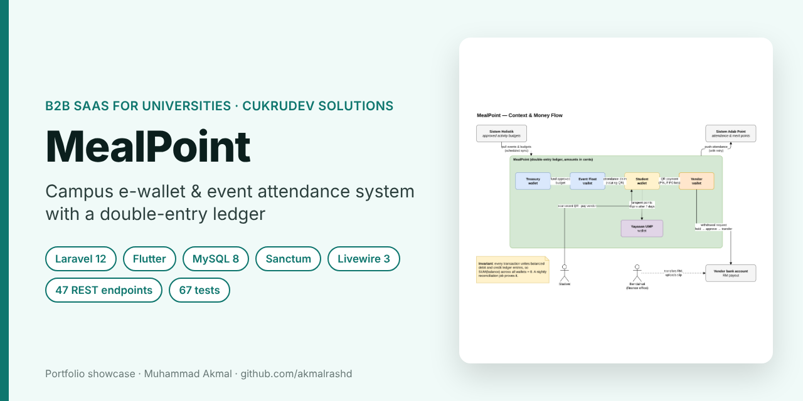
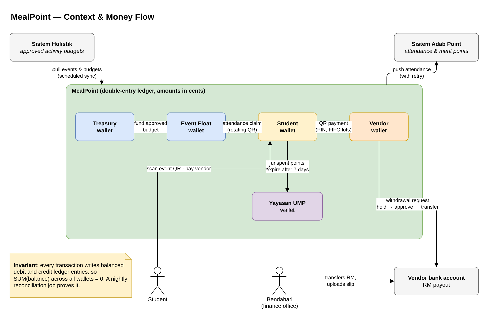
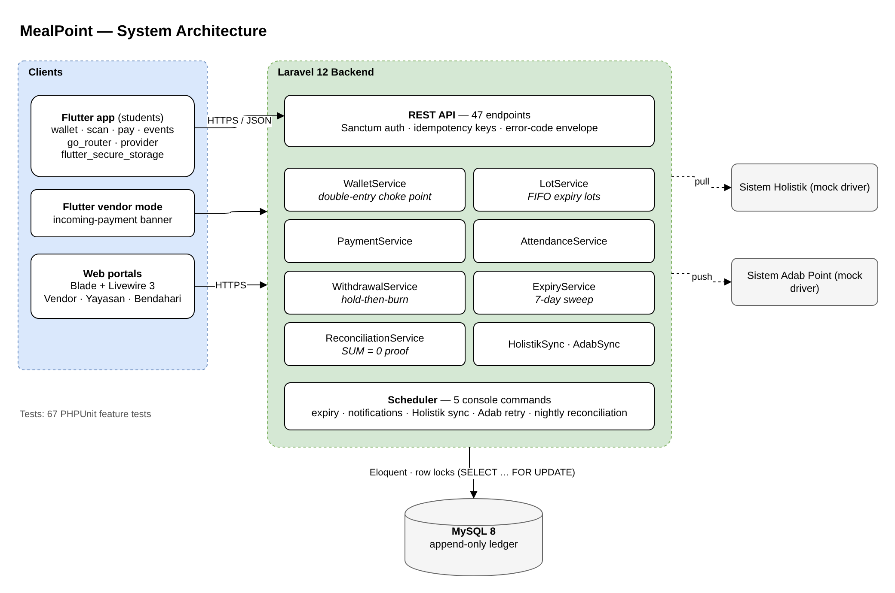
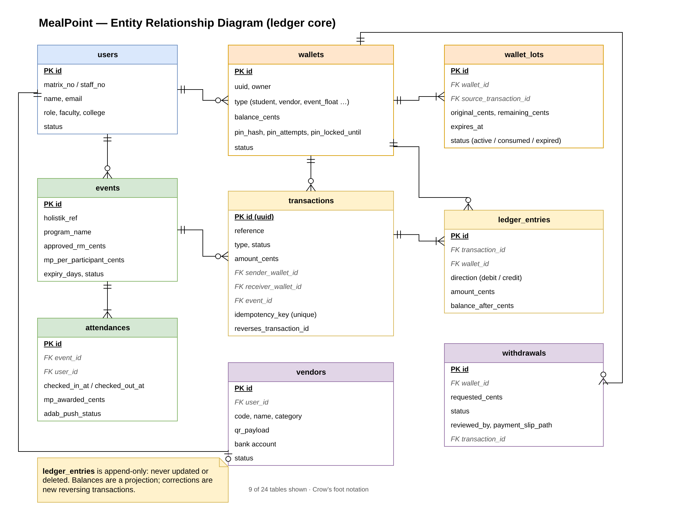
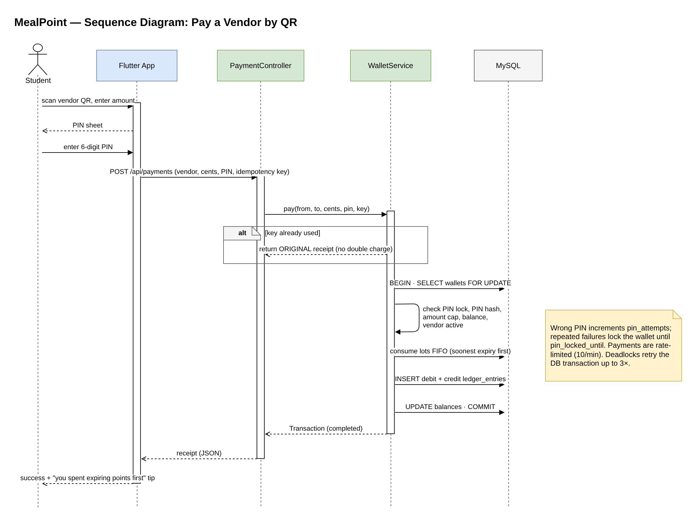

# MealPoint — Campus E-Wallet & Event Attendance System

> **Portfolio showcase.** MealPoint is a B2B product of CukruDev Solutions, so the source code is private.
> This repository explains the design, the money model and my contribution.

**Company:** CukruDev Solutions · **Type:** B2B SaaS for universities and foundations  
**Role:** Full Stack Developer in a 3-person team · **Period:** September – October 2026

---

## The idea

Universities approve budgets for student activities, but the money is hard to track and attendance is easy to fake. MealPoint turns an approved activity budget into **campus credit (MealPoint)** that students earn by actually attending (rotating QR check-in / check-out) and spend at campus food vendors by scanning a QR code. Vendors cash out to their bank account through the finance office, and unspent credit goes to the university foundation (Yayasan) after 7 days.

## What I worked on

- **Ledger and wallet backend** — a double-entry ledger where every payment writes a balanced debit and credit, with FIFO "lots" so credit that expires soonest is spent first.
- **Flutter payment and attendance flow** — PIN-protected QR payment and rotating-QR event check-in, wired to the REST API.
- **Safety rules** — idempotency keys (a retried payment returns the original receipt instead of charging twice), PIN lockout, per-transaction cap and row locking.

## Features

| Who | Features |
|---|---|
| **Student** | Wallet balance with expiring credit, scan-to-pay with 6-digit PIN, event check-in / check-out by rotating QR, transaction history and receipts |
| **Event organiser** | Events and budgets synced from the university activity system, attendance QR with optional geofence |
| **Vendor** | Personal QR code, live incoming-payment banner, withdrawal requests to bank |
| **Yayasan (foundation)** | Receives expired credit, manual donations, its own withdrawals |
| **Bendahari (finance office)** | Approve / reject / mark withdrawals as transferred, reconciliation reports |

## System design

Editable draw.io sources are in [`docs/diagrams`](docs/diagrams).

### Architecture

### ERD — ledger core

### Sequence — paying a vendor by QR

## Engineering highlights

- **Money is stored in cents** (`bigint`), never floats.
- **Append-only ledger:** `ledger_entries` are never updated or deleted; balances are a projection, and mistakes are fixed with reversing transactions.
- **Provable books:** a nightly reconciliation job checks that the sum of all wallet balances is zero.
- **Hold-then-burn withdrawals:** money is held when a vendor requests a withdrawal and only removed after the finance office confirms the bank transfer.
- **Integration-ready:** the university activity system (pull) and merit-point system (push, with retry) sit behind driver interfaces, mocked for the demo.
- **Tested:** 67 PHPUnit feature tests cover the payment happy path, insufficient balance, PIN lockout, FIFO order, idempotent retries, expired / tampered QR codes, the expiry sweep and reconciliation drift.

## Tech stack

| Layer | Technology |
|---|---|
| Backend | Laravel 12, MySQL 8, Sanctum, queued jobs, scheduler (5 commands) |
| API | 47 REST endpoints with a stable error-code envelope |
| Mobile | Flutter (Android, web, Windows), go_router, provider, mobile_scanner, flutter_secure_storage |
| Web portals | Blade, Livewire 3, Tailwind CSS |

## How I used AI tools while building this

I used AI coding assistants (mainly Claude Code) for boilerplate, refactoring suggestions, debugging help and drafting test cases. Design decisions were made as a team; I implemented and reviewed my parts and ran the test suite to check my changes.

## Contact

**Muhammad Akmal bin Mohd Rashid** — Software Engineering student, UMPSA  
📧 work.akmalrashd@gmail.com · 💼 [linkedin.com/in/akmalrashd](https://www.linkedin.com/in/akmalrashd)

© 2026 CukruDev Solutions. Shared for portfolio viewing only; all rights reserved.
